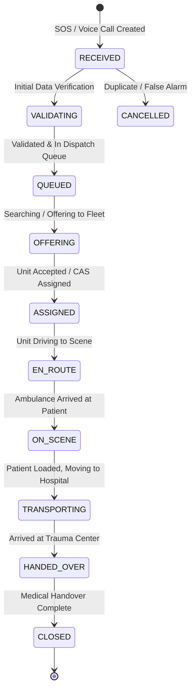
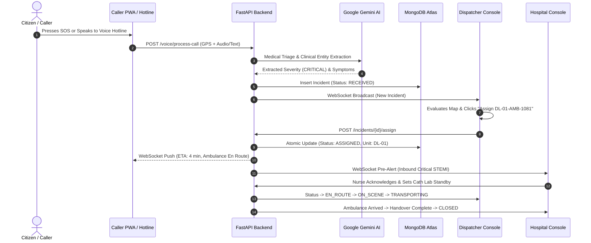

# 🚨 Emergency Medical Response Platform (EMRP) — Complete System Manual

> **Mission**: Deliver a zero-latency, fault-tolerant emergency dispatch and hospital pre-alert platform connecting Citizens, Dispatch Operators, Ambulance Fleets, and Emergency Rooms.

---

## 1. Executive Summary & Core Platform Vision

**EMRP** is an integrated emergency dispatch ecosystem designed to eliminate critical delays during medical emergencies. Traditional dispatch systems suffer from manual address dictation, disconnected ambulance communications, and blind hospital arrivals. 

EMRP replaces fragmented workflows with an automated, synchronized platform:
1. **Citizens & Callers**: Transmit instant GPS-pinned SOS alerts or speak naturally to an automated **Gemini AI Emergency Voice Hotline** without reciting addresses.
2. **Dispatch Operations**: Monitor live fleet telemetry and queue triage on a unified **Mapbox GIS** console with single-click manual or automated algorithmic routing.
3. **Emergency Departments**: Receive real-time clinical pre-alerts and patient vitals while the ambulance is en route to prepare trauma bays, catheterization labs, and surgical teams in advance.

---

## 2. Platform Architecture & Data Flow

```mermaid
flowchart TD
    subgraph Frontend Layer
        A1["Citizen / Caller PWA<br/>(Port 3000)"]
        A2["Dispatcher Console<br/>(Port 3001)"]
        A3["Hospital Console<br/>(Port 3002)"]
    end

    subgraph Ingress & Network
        B1["Reverse Proxy / TLS (Caddy / Vercel / Render)"]
    end

    subgraph Backend Core (FastAPI - Port 8001)
        C1["/api/v1/emergency<br/>(SOS & Tracking)"]
        C2["/api/v1/voice<br/>(AI Hotline & Telephony)"]
        C3["/api/v1/dispatcher<br/>(Fleet & Mission Ops)"]
        C4["/api/v1/fleet<br/>(Telemetry & CAS Dispatch)"]
        C5["/api/v1/hospitals<br/>(Capacity & Pre-alerts)"]
        C6["WebSocket Manager<br/>(Live Pub/Sub)"]
    end

    subgraph AI & Routing Intelligence
        D1["Google Gemini AI<br/>(Speech Triage & Severity Extraction)"]
        D2["OSRM / Mapbox GIS<br/>(Haversine & Road Network Routing)"]
    end

    subgraph Data & Storage Layer
        E1[("MongoDB 7<br/>Replica Set & 2dsphere Geo")]
        E2[("Redis 7<br/>Pub/Sub & Arq Queue")]
    end

    A1 -->|REST / WebSocket| B1
    A2 -->|REST / WebSocket| B1
    A3 -->|REST / WebSocket| B1
    B1 --> C1 & C2 & C3 & C4 & C5 & C6
    C2 --> D1
    C3 --> D2
    C1 & C3 & C4 & C5 --> E1
    C6 --> E2
```

---

## 3. Frontend Applications Breakdown

### 3.1. Caller PWA (`frontend/caller-pwa` — Port 3000)
A mobile-first web app providing rapid emergency access for citizens:
* **High-Precision Geolocation**: Browser GPS auto-lock with accuracy categorization (`Good` $\le 30\text{m}$, `Fair` $\le 100\text{m}$, `Poor` $> 100\text{m}$).
* **Instant SOS Submission**: High-contrast, one-click SOS button utilizing client-generated `Idempotency-Key` headers to prevent accidental duplicate submissions.
* **Interactive Emergency Estimator**: Interactive triage selector (Critical, High, Medium, Low) that calculates estimated response times, assigned vehicle types (ACLS, ALS, BLS, PTU), and receiving medical centers.
* **Automated AI Voice Hotline Modal (`VoiceHotlineModal.tsx`)**:
  - Simulates a 24/7 designated emergency hotline (+91 11 4084 9108).
  - Uses browser Speech Recognition (`webkitSpeechRecognition`) and Speech Synthesis to ask: *"Emergency medical response automated hotline. What is the case?"*
  - Automatically captures the caller's phone and coordinates, sends audio/transcript to `/api/v1/voice/process-call`, triages with Gemini AI, and generates the incident without requiring manual address entry.
* **Live Incident Tracking**: Connects to `/api/v1/emergency/{id}/ws` WebSocket to display real-time ETA countdowns and status transitions (`RECEIVED` $\rightarrow$ `ASSIGNED` $\rightarrow$ `EN_ROUTE` $\rightarrow$ `ON_SCENE`).

---

### 3.2. Dispatcher Operations Console (`frontend/dispatcher` — Port 3001)
A zero-outer-scroll mission-control interface built for high-stress operations:
* **Emergency Queue Column**:
  - Lists real active incidents sorted chronologically.
  - Severity-coded indicators (Red = Critical, Orange = High, Yellow = Medium, Blue = Low).
  - Status badges (`RECEIVED`, `QUEUED`, `ASSIGNED`, `EN_ROUTE`, `ON_SCENE`).
* **Mapbox Interactive GIS Map (`IncidentMap.tsx`)**:
  - Live patient scene markers with pulsing accuracy radiuses.
  - Color-coded ambulance icons dynamically positioned via GPS coordinates.
  - Interactive route lines illustrating the two critical legs:
    - **Leg 1**: Ambulance $\rightarrow$ Patient Scene
    - **Leg 2**: Patient Scene $\rightarrow$ Hospital Emergency Room
* **Fleet Management Column**:
  - Displays registered ambulance units (`DL-01-AMB-1081`, etc.), crew medical capabilities (`ALS`, `VENTILATOR`, `BLS`, `NEONATAL`), and status (`AVAILABLE`, `DISPATCHED`).
  - **Manual Dispatch**: Operators can assign any available ambulance to the selected incident with a single click.
  - **AI Auto-Dispatch**: Automatically queries nearest available unit via geo-proximity algorithms.
* **Real-time Mission Route Metrics Bar**:
  - Computes exact driving distances and ETAs for both route legs and displays the total end-to-end mission duration.

---

### 3.3. Hospital Emergency Console (`frontend/hospital` — Port 3002)
Tailored for emergency department triage nurses and trauma team leads:
* **Inbound Pre-Alert Board**: Live feed of approaching ambulances, triage severity categories (Red/Yellow/Green), and live countdown ETAs to hospital bay doors.
* **Real-time Inbound Patient Vitals**: Displays field paramedic readings before the ambulance arrives:
  - Heart Rate (BPM), Blood Pressure (mmHg), $\text{SpO}_2$ (%), Respiratory Rate, and Glasgow Coma Scale (GCS).
* **Facility Capacity Control**: Toggle button switches for instant capacity adjustments:
  - Resuscitation Bays, ICU Beds, Operating Rooms available.
  - Operational flags for CT Scanner, Cath Lab Standby, and Trauma Team activation.
* **One-Click Pre-Alert Acknowledgment**: Allows the charge nurse to confirm receipt and verify bed reservations directly back to the dispatch engine.

---

## 4. Backend Architecture & REST/WebSocket API Reference

The backend is built with **FastAPI**, **Pydantic v2**, and **Motor (Async MongoDB)**.

### 4.1. Core Routers & Endpoints

| Method | Endpoint | Description |
|---|---|---|
| `POST` | `/api/v1/auth/register` | Register new user (Caller, Dispatcher, Hospital Admin) |
| `POST` | `/api/v1/auth/token` | OAuth2 password login returning Bearer JWT |
| `POST` | `/api/v1/emergency/sos` | Create new emergency incident (Requires `Idempotency-Key`) |
| `GET` | `/api/v1/emergency/{id}` | Retrieve incident state and tracking information |
| `PATCH`| `/api/v1/emergency/{id}/status` | Execute validated FSM transition on incident |
| `WS` | `/api/v1/emergency/{id}/ws` | WebSocket status feed for callers |
| `POST` | `/api/v1/voice/process-call` | Voice IVR ingestion: Gemini audio triage + incident creation |
| `GET` | `/api/v1/voice/hotline-config` | Configuration for emergency phone scripts & phone lines |
| `POST` | `/api/v1/voice/twiml/inbound` | Standard telephony webhook for SIP/Twilio trunks |
| `GET` | `/api/v1/dispatcher/incidents` | List all active (non-terminal) incidents for queue |
| `GET` | `/api/v1/dispatcher/fleet` | Real-time coordinates and availability of all ambulances |
| `POST` | `/api/v1/dispatcher/incidents/{id}/assign` | Manually dispatch specific ambulance unit to incident |
| `POST` | `/api/v1/dispatcher/incidents/{id}/auto-assign`| Nearest-neighbor algorithmic ambulance assignment |
| `GET` | `/api/v1/dispatcher/incidents/{id}/route-metrics` | Multi-leg route calculations (OSRM / Haversine) |
| `GET` | `/api/v1/fleet/` | Retrieve full registered ambulance fleet |
| `PATCH`| `/api/v1/fleet/{id}/telemetry` | Ingest live GPS coordinates from vehicle MDT units |
| `GET` | `/api/v1/hospitals/` | List hospital facilities and trauma capabilities |
| `PATCH`| `/api/v1/hospitals/{id}/capacity` | Update ICU/ER bed capacity and surgical status |
| `GET` | `/health` | Healthcheck endpoint (`{"status": "ok"}`) |

---

## 5. State Machines & Reliability Guarantees

### 5.1. Incident State Machine (`IncidentStatus`)



### 5.2. Concurrency & Data Guarantees
1. **Idempotency**: All incident creation requires a unique `Idempotency-Key`. Re-transmissions within the dedup window immediately return the original record without duplicate database inserts.
2. **Race-Free CAS (Compare-And-Swap)**: Ambulances are assigned using atomic database operations matching `{"_id": unit_id, "status": "AVAILABLE"}` ensuring two dispatchers can never assign the same ambulance to different incidents simultaneously.
3. **Sortable Unique Identifiers (ULID)**: Documents use millisecond-sortable 128-bit ULIDs generated via `ulid.new()`, ensuring chronological indexing and zero primary-key collisions.
4. **Resilient Fallback Parsing**: If external AI (Gemini) or routing engines (OSRM) experience network timeouts, rule-based clinical heuristic parsers and geodesic Haversine distance fallbacks maintain platform operation without failure.

---

## 6. Database Collections Schema (MongoDB 7)

* **`incidents`**: Stores incident ID, coordinates (`GeoJSON Point`), severity (`CRITICAL`, `HIGH`, `MEDIUM`, `LOW`), caller metadata, assigned vehicle ID, destination hospital ID, timestamps for each lifecycle transition, and Gemini triage transcripts.
* **`ambulances`**: Unit identifier, vehicle registration, crew capabilities (`ALS`, `BLS`, `VENTILATOR`, `NEONATAL`), live GPS location, status (`AVAILABLE`, `DISPATCHED`, `ON_SCENE`, `MAINTENANCE`), and last seen ping.
* **`hospitals`**: Facility name, coordinates, trauma level designation, available bed counters (ER, ICU, OR), and equipment flags (CT scanner, Cath Lab).
* **`audit_log`**: Append-only tamper-evident audit record capturing actor ID, timestamp, transition state, and SHA-256 hash chains.

---

## 7. Step-by-Step Incident Walkthrough



---

## 8. Deployment & Operational Runbook

### 8.1. Running the Complete System Locally
To run all 4 services on your development machine:

```powershell
# 1. Start Backend API Server (Port 8001)
cd backend
python -m uvicorn app.main:app --host 127.0.0.1 --port 8001

# 2. Start Caller PWA Portal (Port 3000)
cd frontend/caller-pwa
npm run dev -- -p 3000

# 3. Start Dispatcher Console (Port 3001)
cd frontend/dispatcher
npm run dev -- -p 3001

# 4. Start Hospital Console (Port 3002)
cd frontend/hospital
npm run dev -- -p 3002
```

### 8.2. Service Port Matrix
* **Backend API & Swagger Docs**: `http://localhost:8001` (Docs: `http://localhost:8001/api/docs`)
* **Caller PWA / Citizen Emergency Portal**: `http://localhost:3000`
* **Dispatcher Operations Console**: `http://localhost:3001`
* **Hospital Emergency Console**: `http://localhost:3002`

### 8.3. Production Cloud Deployment
* **Backend**: Hosted on Render (`https://emrp.onrender.com`), automatically deployed from branch `main` via `render.yaml`.
* **Frontend Apps**: Hosted on Vercel, pointing `NEXT_PUBLIC_API_URL` to `https://emrp.onrender.com/api/v1` and `NEXT_PUBLIC_WS_URL` to `wss://emrp.onrender.com/api/v1`.

